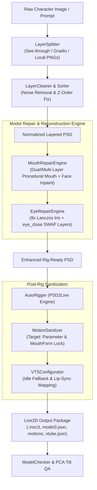

<div align="center">

# 🎭 Live2D Avatar Pipeline

**Automated 2D Character Layer Decomposition, Live2D Rigging & Model Repair Toolkit**  
*从二次元立绘到可动皮套的一站式自动化拆层、分层绑定、口型眼部程序化修复与动作安全加固工具链*

[](https://www.python.org/)
[](https://www.live2d.com/)
[](https://denchisoft.com/)
[](LICENSE)
[](https://github.com/Ran1013)

[English](#english) | [中文说明](#中文说明)

</div>

---

<span id="english"></span>
## 📖 Overview

**Live2D Avatar Pipeline** solves the most notorious pain points when transforming AI-generated 2D anime illustrations into high-performance, broadcast-ready Live2D models.

Traditional automated tools frequently suffer from:
1. **Mouth Deformation & Tilting**: Single-layer mouth mesh interpolation results in downward sagging, asymmetric skew, and double-lip ghosting.
2. **Jagged Blinking**: Direct mesh squishing of open eyelashes causes severe polygon folding, jagged edges, and texture tearing.
3. **Engine Crashes**: Auto-riggers frequently output invalid `"Target": "Model"` curves in `*.motion3.json`, triggering Unity Cubism SDK `ThrowArgumentNullException` crashes in VTube Studio.
4. **Frozen Lost-Tracking State**: Lack of fallback idle animations when webcam tracking drops.

This toolkit provides an end-to-end Python pipeline and CLI to **split flat images into clean layers, procedurally synthesize dual/multi-layer mouths and swap-ready eye layers, auto-rig via headless PSD2Live, and sanitize animation curves**.

---

<span id="中文说明"></span>
## 🌟 核心特性 (Key Features)

- 🎨 **智能图层拆解与规范化 (Smart Layer Splitting & Order Normalization)**:
  - 支持调用 See-Through / Gradio API 进行透明图层分解，或一键组装分散图层为规范 PSD。
  - 严格保障 18+ 核心部件图层次序（解决双手被外套遮挡、眼白遮盖虹膜、幽灵图层残影等问题）。
  - 自动收紧图层包围盒并清除边缘低透明度散斑杂色。

- 👄 **程序化双层/五层嘴型重构 (Procedural Mouth Engine)**:
  - 彻底根治单层嘴在说话时的**偏斜、下垂、尖突**与**黑洞感**。
  - 贝塞尔曲线结合 8x 超采样预乘 Alpha Lanczos 抗锯齿渲染。
  - 自动对脸部底板执行周围肤色双向插值 Inpainting，彻底消除开嘴时的“双重唇线”残留。
  - 自动配置 `ParamMouthOpenY` 的 Keyform 透明度切换逻辑。

- 👁️ **明眸重建与闭眼置换机制 (Eye Inpainting & Swap-Blink)**:
  - 8x 超采样重塑双瞳层次（深蓝渐变 + 月牙微光 + 纯净星芒十字/四角星主高光）。
  - 动态生成专用 `eye_close-l` / `eye_close-r` 睫毛图层，原生触发 `SWAP=0.06f` 闭眼置换机制，告别网格挤压导致的睫毛折痕与锯齿。

- 🛡️ **动画曲线安全修复与加固 (Motion Curve Sanitizer)**:
  - 自动检测并修正 `*.motion3.json` 中的非法 `"Target": "Model"` 字段为 `"Parameter"`，杜绝 VTube Studio 底层空指针抛弃动画。
  - 锁定 `ParamMouthForm = 0.0` 消除说话下唇尖锐突起；动态放大 `ParamMouthOpenY` 幅度（1.35x ~ 1.5x），让直播小窗下的张嘴清晰可见。
  - 消除点头/摇头动作中的身体过度扭曲与腿部拉窄瑕疵。

- 🚀 **自动化绑定与三端同步 (Auto-Rigging & QA)**:
  - 驱动 PSD2Live 无头服务自动化导入、自动图层分类、图集排布（4096px 预算）、重建绑定与 VTube Studio 导出。
  - 内置基于 PCA（主成分分析）的嘴部水平倾角测量与模型文件完整度质检（QA）。

---

## 🏗️ 架构与数据流 (Architecture)



---

## ⚡ 快速开始 (Quick Start)

### 1. 环境准备 (Installation)

```bash
# 克隆仓库
git clone https://github.com/Ran1013/live2d-avatar-pipeline.git
cd live2d-avatar-pipeline

# 安装依赖
pip install -r requirements.txt

# 以可编辑模式安装 CLI
pip install -e .
```

### 2. 环境变量配置 (Environment Setup)

复制并根据需要配置 `.env`：

```bash
cp .env.example .env
```

- `HF_TOKEN`: 用于调用 Hugging Face Space See-through 拆层 API（可选）。
- `PSD2LIVE_TOKEN`: PSD2Live MCP 服务授权凭证（在 macOS 上会自动从系统偏好项读取，无需手动配置）。

---

## 💻 命令行用法 (CLI Reference)

本工具提供了简洁统一的 `avatar-pipeline` 命令行：

### ① 图层拆分与规范化 (Split & Normalize)
```bash
# 将零散的图层 PNG 文件夹一键合成标准化 PSD
avatar-pipeline split ./character_layers/ -o ./character_normalized.psd

# 对已有 PSD 进行图层排序规范化与杂色清除
avatar-pipeline split ./raw_model.psd -o ./model_clean.psd
```

### ② 口型程序化修复 (Procedural Mouth Repair)
```bash
# 在指定脸部包围盒内自动生成平滑双层嘴，消除原图脸部闭嘴线
avatar-pipeline repair-mouth ./character.psd -o ./character_mouth_fixed.psd \
    --x0 620 --y0 220 --x1 662 --y1 248 \
    --rx 16.0 --depth 12.0 --preview ./preview_mouth.png
```

### ③ 眼部闭眼置换图层生成 (Eye Repair & Swap Layers)
```bash
# 自动注入 eye_close-l 与 eye_close-r 专用闭眼图层
avatar-pipeline repair-eyes ./character.psd -o ./character_eyes_fixed.psd
```

### ④ 动作曲线清洗与安全加固 (Motion Sanitization)
```bash
# 修复整个模型目录下的所有 *.motion3.json 文件
avatar-pipeline sanitize-motion ./output/MyModel/ --boost 1.4
```

### ⑤ 自动化绑定与导出 (Automated Rigging)
```bash
# 自动导入 PSD，分配图层角色，设置 4096 图集并导出 VTube Studio 模型包
avatar-pipeline rig ./character_enhanced.psd -o ./output/MyModel/ \
    --roles ./config/default_roles.json --atlas 4096 --boost 1.35
```

### ⑥ 模型完整性质检 (Model QA)
```bash
# 自动化质检模型包完整度，检查贴图、曲线目标与文件引用
avatar-pipeline qa ./output/MyModel/
```

---

## 🐍 Python API 示例 (Python Usage)

```python
from live2d_pipeline.repair import MouthRepairEngine, EyeRepairEngine, MotionSanitizer
from live2d_pipeline.qa import calculate_tilt_angle_pca, ModelChecker

# 1. 修复嘴部并在脸部消除旧闭嘴唇线
MouthRepairEngine.apply_dual_mouth(
    input_psd="character.psd",
    output_psd="character_fixed.psd",
    box=(620, 220, 662, 248),
    rx=16.0,
    depth=12.0,
    preview_png="mouth_preview.png"
)

# 2. 生成闭眼置换图层
EyeRepairEngine.add_close_eye_swap_layers(
    input_psd="character_fixed.psd",
    output_psd="character_ready.psd"
)

# 3. 校验并加固动作文件
MotionSanitizer.sanitize_model_directory("./output/MyModel/", mouth_open_boost=1.35)

# 4. 质检模型包
report = ModelChecker.inspect_model_directory("./output/MyModel/")
print("Model Valid:", report["valid"])
```

---

## 📂 项目结构 (Project Structure)

```text
live2d-avatar-pipeline/
├── live2d_pipeline/
│   ├── core/              # PSD I/O (NumPy 2.x safe), P2L Client, Resampling Utils
│   ├── splitter/          # Layer decomposition, draw-order sorting, speck cleaning
│   ├── repair/            # Procedural mouth engine, eye reconstruction, motion sanitizer
│   ├── rigger/            # Automated rigging orchestrator with PSD2Live
│   ├── qa/                # PCA tilt calculator, model3 validator
│   └── cli.py             # Command-line interface
├── config/
│   ├── default_roles.json # Standard 27-layer Live2D classification map
│   └── pipeline_config.yaml # Default tuning parameters
├── docs/
│   ├── ARCHITECTURE.md    # In-depth architectural specifications & layer rules
│   ├── PROMPT_GUIDE.md    # 2D character generation prompt engineering checklist
│   └── TROUBLESHOOTING.md # Detailed breakdown of common Live2D / VTS engine bugs
├── examples/
│   └── demo_pipeline.py   # Quick runnable Python demo script
├── tests/                 # Unit tests (unittest based)
├── pyproject.toml         # Packaging configuration
├── requirements.txt       # Dependencies
└── LICENSE                # MIT License
```

---

## 🤝 贡献与许可 (Contributing & License)

欢迎提交 Issue 和 Pull Request！

本项目基于 [MIT 许可证](LICENSE) 开源。
Copyright (c) 2026 [Ran1013](https://github.com/Ran1013).
