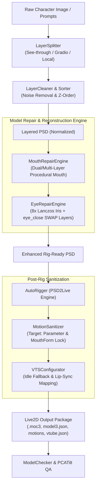

# System Architecture & Technical Design

The **Live2D Avatar Pipeline** automates the entire lifecycle of converting flat 2D anime character images into fully rigged, broadcast-ready Live2D models.

---

## 1. Key Technical Innovations

### 1.1 Procedural Multi-Layer Mouth Engine
- **The Problem**: Automatic Live2D rigging creates single-layer mesh deformations on the face, causing downward sagging, asymmetric tilting during speech, and black-hole distortion.
- **The Solution**: 
  - Generates independent `lips` (closed smile line) and `oral` (open cavity) or 5-layer components (`上唇线`, `下唇线`, `上牙`, `舌头`, `口腔`).
  - Keyform Opacity Switching:
    - `ParamMouthOpenY = 0.0`: Closed lips visible, oral cavity opacity = 0.
    - `ParamMouthOpenY >= 0.05`: Oral cavity opacity = 1, lips transition smoothly.
  - Inpaints face skin behind the mouth box to eradicate double-lip ghosting.
  - Employs 8x super-sampling with premultiplied alpha Lanczos downsampling to prevent dark fringes or pixelated edges.

### 1.2 Dedicated `eye_close` SWAP Mechanism
- **The Problem**: Squishing open eyelash meshes to simulate closed eyes causes jagged edges, texture pinching, and unnatural folds.
- **The Solution**:
  - Dynamically synthesizes dedicated `eye_close-l` and `eye_close-r` layers along cubic Bezier curves.
  - Triggers PSD2Live's native `SWAP=0.06f` threshold: when eye openness drops below 0.06, the engine swaps to the dedicated closed-eye layer rather than squishing the mesh.

### 1.3 Motion Curve Target Sanitizer
- **The Problem**: Auto-generated motion curves occasionally assign `"Target": "Model"`. Unity's Cubism Framework throws `ThrowArgumentNullException` when loading curves with Model target, causing VTube Studio to drop the animation file completely.
- **The Solution**:
  - Validates and enforces `"Target": "Parameter"` across all curve descriptors.
  - Locks `ParamMouthForm = 0.0` to eliminate pointed lower lip deformation.
  - Dynamically amplifies `ParamMouthOpenY` curves (1.35x ~ 1.5x) so lip movement is clearly visible in broadcast windows.
  - Recomputes and updates `Meta.TotalSegmentCount` and `Meta.TotalPointCount`.

---

## 2. Standard Layer Hierarchy

| Draw Order | Layer Name | Role | Function |
|---|---|---|---|
| 0 | `front hair` / `bangs` | hair front | Forefront bangs and side hair |
| 1 | `headwear` | accessory | Hairpins, ribbons, hats |
| 2 | `eye_close-l`, `eye_close-r` | eyelash closed | Dedicated closed-eye layers (SWAP mode) |
| 3 | `eyebrow-l`, `eyebrow-r` | eyebrow | Left & right eyebrows |
| 4 | `eyelash-l`, `eyelash-r` | eyelash | Upper and lower eyelashes |
| 5 | `irides-l`, `irides-r` | iris | Iris and pupils with star highlights |
| 6 | `eyewhite-l`, `eyewhite-r` | eyewhite | Sclera / eye whites |
| 7 | `nose` | nose | Nose line and highlight |
| 8 | `lips` / `oral` (or 5-layer mouth) | mouth | Procedural mouth stack |
| 9 | `face` | face | Facial skin (with mouth line inpainted) |
| 10 | `ears-l`, `ears-r` | ear | Ears |
| 11 | `handwear-l`, `handwear-r` | arm | Hands and arms (**must be above topwear**) |
| 12 | `neck` | neck | Neck and collar shadow |
| 13 | `topwear` | topwear | Shirts, jackets, coats |
| 14 | `bottomwear` | bottomwear | Skirts, shorts, trousers |
| 15 | `legwear` | leg | Legs and thighs |
| 16 | `footwear` | foot | Shoes and boots |
| 17 | `back hair` | hair back | Ponytails, long back hair |
